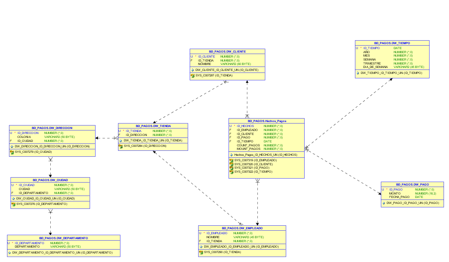

# SQL Data Warehouse & ETL

Three end-to-end data warehouse builds (OLTP model → dimensional model → ETL → business reports) plus Oracle PL/SQL work, written for the Databases II course at UNAH (Universidad Nacional Autónoma de Honduras), 2021.

| Project | Source → target | Model | ETL tool | What to look at |
|---|---|---|---|---|
| [`maintenance-dw`](maintenance-dw) | Equipment-maintenance OLTP → DW, SQL Server **and** Oracle | Star schema: `FactMaintenances` + 7 dimensions (time, materials, equipment, employees, maintenances, orders, order items) | Pentaho Data Integration (Kettle): one job per load stage, one transformation per dimension | 10 business questions answered with drill-down / drill-up reports in [`docs/reports`](maintenance-dw/docs/reports) |
| [`payments-dw`](payments-dw) | `PAGOS` (payments) OLTP → `DW_PAGOS`, SQL Server | Snowflake: `HECHOS_PAGOS` with customer, employee, store, time and a city → department geography chain | SQL Server Integration Services (SSIS) | [`docs/snowflake-model.png`](payments-dw/docs/snowflake-model.png), [`etl/source_queries.sql`](payments-dw/etl/source_queries.sql) |
| [`northwind-etl`](northwind-etl) | Microsoft Northwind → `DW_NORTHWIND`, SQL Server | Orders fact with time, product, employee and shipper dimensions | SSIS | [`source_queries.sql`](northwind-etl/source_queries.sql) and the sales-by-quarter-and-employee report |
| [`plsql`](plsql) | Oracle XE | — | SQL\*Loader | Packages with cursors and exception handling, triggers and sequences, `DBMS_SCHEDULER` jobs, SQL\*Loader control files |

## How the warehouses were built

1. Write the business questions and the metrics each one needs.
2. Pick the facts and dimensions that answer them, then the model (star or snowflake).
3. Map every dimension and fact column to its OLTP source; those mappings are the `source_queries.sql` files.
4. Build the ETL: load dimensions first, then facts, clearing the targets on each full reload.
5. Answer the questions with reports over the warehouse.

## Run it

**maintenance-dw (SQL Server).** Run `oltp/sqlserver/oltp_maintenance.sql` (schema + sample data), then `dw/sqlserver/dw_maintenance.sql`. Open `etl/pentaho/ETL_Maintenance.kjb` in Pentaho Data Integration (Spoon), set the connection password (left blank in this repo) and run the job. Oracle versions of both scripts are under `oltp/oracle` and `dw/oracle`.

**payments-dw and northwind-etl.** Open the `.sln` in Visual Studio with SQL Server Integration Services Projects. Connections point to `localhost`. The `PAGOS` source database and the `DW_NORTHWIND` target schema were provided by the course and are not included; Northwind is Microsoft's sample database ([microsoft/sql-server-samples](https://github.com/microsoft/sql-server-samples/tree/master/samples/databases/northwind-pubs)).

**plsql.** Run in Oracle XE as a schema user. SQL\*Loader commands are in `plsql/sql-loader/*/3_run_command.txt`; replace `<password>`.

## Notes

- Code comments and some object names are in Spanish.
- Sample rows use fictional data (the maintenance OLTP reuses names from Oracle's HR sample schema).
- Course statements, exams, slides and other students' work are not included and are not covered by the license.

## License

[MIT](LICENSE) © 2021 Edgar Benedetto
